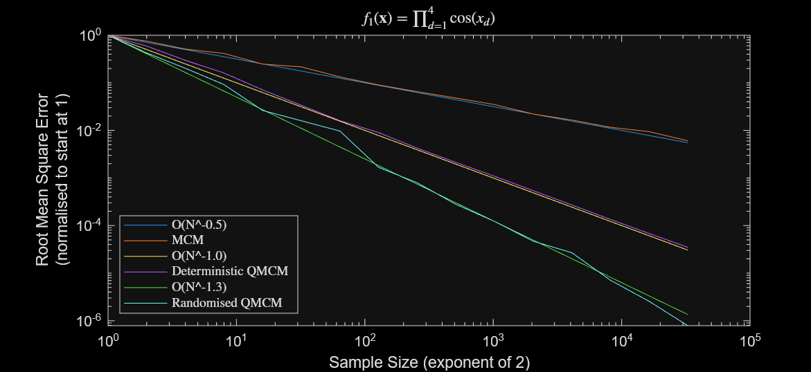
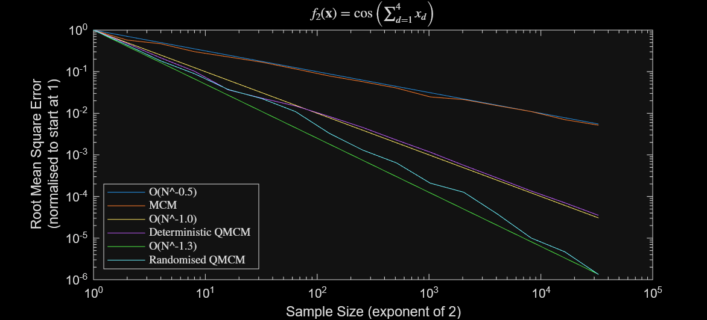
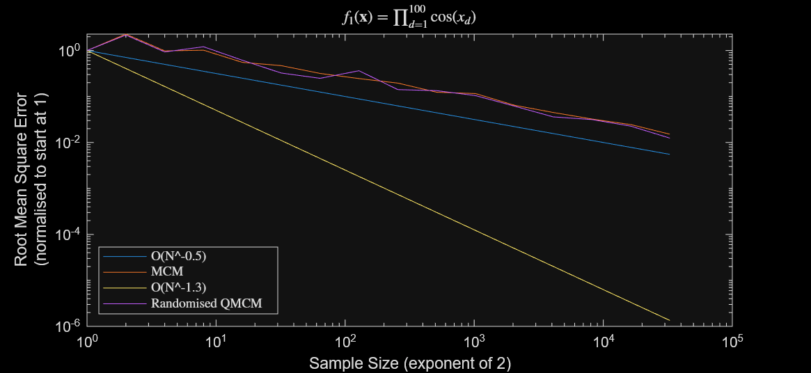

# Monte Carlo & Quasi-Monte Carlo Experiments

A collection of MATLAB scripts comparing the convergence rates of Monte Carlo Methods (MCM) against Quasi-Monte Carlo Methods (QMCM and Randomized QMCM) for multidimensional numerical integration over $[0, 1]^d$.

Note: The script [MCMs_fx.m](MCMs_fx.m) allows for custom functions.

---

## Methods Compared

- **MCM (Monte Carlo Method)**: Pseudo-random sampling $\mathcal{O}(N^{-0.5})$.
- **Deterministic QMCM**: Non-scrambled Sobol sequence sampling $\approx \mathcal{O}(N^{-1.0})$ in moderate dimensions.
- **Randomised QMCM (RQMCM)**: Owen-scrambled Sobol sequence sampling (MatousekAffineOwen) $\approx \mathcal{O}(N^{-1.3})$.
- Convergence rates shown are in low dimensions.

---

## Results

### 1. Test Function 1: Product of Cosines ($d = 4$)

$$f_1(\mathbf{x}) = \prod_{d=1}^{4} \cos(x_d), \quad \mathbf{x} \in [0, 1]^4$$

- **Analytical Integral**: $\sin(1)^4$
- **Script**: `MCMs_f1.m`

> **Observation**: In 4 dimensions, Deterministic QMCM attains $\sim \mathcal{O}(N^{-1.0})$ error decay, while Randomised QMCM achieves the fastest convergence rate near $\mathcal{O}(N^{-1.3})$.

---

### 2. Test Function 2: Cosine of Sum ($d = 4$)

$$f_2(\mathbf{x}) = \cos\left(\sum_{d=1}^{4} x_d\right), \quad \mathbf{x} \in [0, 1]^4$$

- **Analytical Integral**: Computed with MATLAB Symbolic Math Toolbox
- **Script**: `MCMs_f2.m`

> **Observation**: Consistent with $f_1$, RQMCM outperforms both standard MCM and deterministic QMCM on non-separable integrand $f_2$.

---

### 3. High-Dimensional Case ($d = 100$)

$$f_1(\mathbf{x}) = \prod_{d=1}^{100} \cos(x_d), \quad \mathbf{x} \in [0, 1]^{100}$$

- **Analytical Integral**: $\sin(1)^{100}$
- **Script**: `MCMs_f1_high_dimensional.m`

> **Observation**: In high dimensions ($d = 100$), the result blows up, QMCM deteriorates is very hard to compute and omitted here due to the curse of dimensionality. RQMCM convergence degrades and approaches the MCM rate ($\mathcal{O}(N^{-0.5})$).
